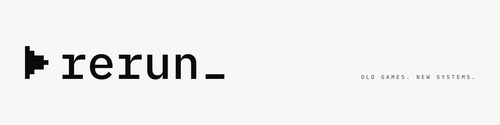

<picture>
  <source media="(prefers-color-scheme: dark)" srcset="brand/social/readme-header-dark.png">
  
</picture>

Old games. New systems.

Rerun detects your installed PC games and applies the compatibility fixes they need on Windows 11: CPU affinity, compatibility modes, DLL wrappers like DXVK or dgVoodoo 2, community patches and launch options. Every change is previewed first, logged, and can be reverted completely.

- No background process. Nothing runs unless you start a game through it.
- Fixes only apply when they match your GPU, CPU and Windows build.
- Only original, verified sources. Pinned versions, checked hashes.

**Status:** early development, not ready for use. Detection, the reversible primitives with their journal, and launching with CPU rules work as a command-line tool (phases 1–3); topos and packages (phase 4) and the app (phase 5) are next. See [`docs/08-roadmap.md`](docs/08-roadmap.md).

Rerun by Mythen Studios.

## License

The Rerun source code is licensed under the [GNU General Public License v3.0 or later](LICENSE) (`GPL-3.0-or-later`).
The app binary `rerun-app.exe` links the Slint UI toolkit under its GPL-3.0-only option, so the distributed `rerun-app.exe` is effectively `GPL-3.0-only`; `rerun.exe`, `rerun-launch.exe`, `rerun-helper.exe` and `rerun-cpu.asi` do not link Slint and stay `GPL-3.0-or-later` (ADR 0026).
Game recipes (topos) and package descriptions will be licensed separately.
The Rerun name, logo and brand assets in `brand/` (and their copies in `crates/rerun-app/assets/`) are not covered by the code license; see `brand/BRAND.md`.
