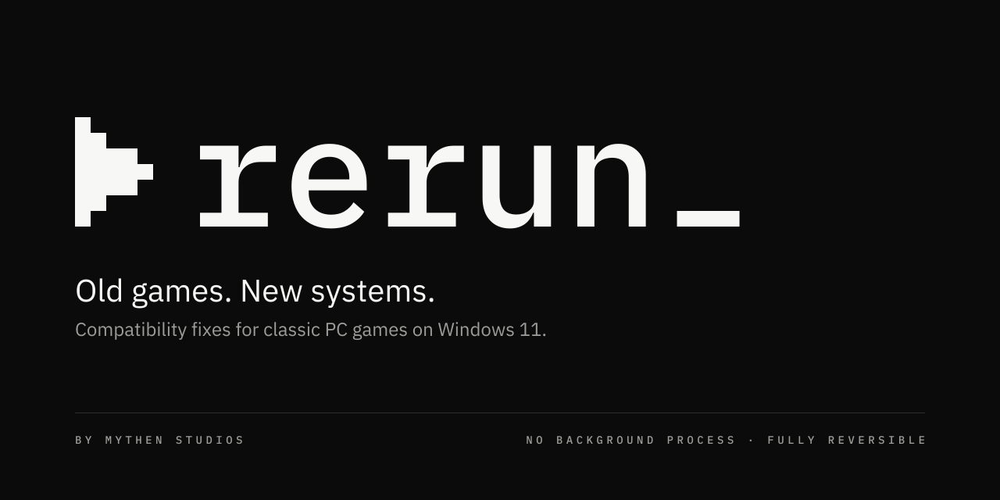

# Rerun · Brand kit

Rerun by Mythen Studios. Black and white, pixel grid, terminal prompt.



## Mark

A play triangle with a cursor on an **8 × 7 grid**, like a terminal prompt `▶_`: play again, by command.

```
█·······
██······
████····
█████···
████····
██······
█·····██
```

- Scale only by **integer multiples** of a cell (16 px wide = 2 px per cell, 64 px = 8 px …). Otherwise the edges blur.
- In SVG use `shape-rendering="crispEdges"`, in CSS `image-rendering: pixelated` for PNGs.
- Minimum size: 16 px wide (2 px cell).

## Wordmark and lockup

- Wordmark: **rerun** in IBM Plex Mono Medium, lowercase, followed by a cursor block (4 × 1 cells) on the baseline: `rerun_`.
- Lockup: triangle **without** cursor + wordmark: `▶ rerun_`. The cursor appears only once, at the end of the word.
- Grid in the lockup: cap height of the type = 7 cells = height of the mark. Gap triangle → word: 3 cells.
- Sender line below, aligned with the word: `BY MYTHEN STUDIOS` in Plex Mono, uppercase, letter spacing 0.32em, muted grey.

## Clear space

Keep at least **2 cells** free around the mark and the lockup. Put nothing into the space between triangle and word.

## Colors

Same as Mythen Studios. No accent color. The names `fels` (rock, dark) and `schnee` (snow, light) are also used in the file names.

| Name | Hex | Use |
|---|---|---|
| fels | `#0b0b0b` | Background (dark, default), logo on light |
| schnee | `#f7f7f5` | Logo on dark, light background |
| stein-900 | `#161615` | Surfaces on fels |
| stein-700 | `#2e2e2c` | Lines on fels |
| muted (dark) | `#9c9c98` | Secondary text on fels |
| muted (light) | `#5c5c59` | Secondary text on schnee |

Never pure `#000` or `#fff`.

## Type

- **IBM Plex Mono** (500): wordmark, labels, paths, commands, versions.
- **IBM Plex Sans** (400/600): body text, taglines.
- All free (Google Fonts, SIL OFL).

## Voice

Tagline: **Old games. New systems.**
Tone: calm, direct, concise. No superlatives, no exclamation marks.

## Never

- Recolor, distort, rotate or blur the mark, or add shadows, glow or gradients
- Scale by non-integer factors
- Smooth the triangle or redraw it as a "proper" play symbol
- Show the cursor twice (mark with cursor + wordmark)
- Place the Rerun mark and the Mythen mark large side by side on the same surface

## Files

| File | Use |
|---|---|
| `logo/rerun-mark-{schnee,fels}.svg` | Mark alone, vector |
| `logo/rerun-mark-{schnee,fels}-512.png` | Mark, transparent: Discord, itch.io, presentations |
| `logo/rerun-wordmark-{schnee,fels}.svg` | Wordmark alone |
| `logo/rerun-lockup-{schnee,fels}.svg/.png` | Default logo |
| `logo/rerun-lockup-mythen-{schnee,fels}.svg/.png` | With sender line "by Mythen Studios" |
| `icon/rerun.ico` | Windows icon of the exe (16–256 px, pixel-exact) |
| `icon/app-icon-{16…1024}.png` | App icon, each size rasterized separately |
| `icon/favicon.ico`, `icon/favicon.svg` | Website |
| `social/github-social-preview.png` | GitHub: Settings → Social preview (1280 × 640) |
| `social/readme-header-{dark,light}.png` | README header, matching light/dark mode |
| `social/avatar-512.png` | Square, works with a round crop |
| `tools/gen.py` | Generator: regenerates everything |

`schnee` = light logo for dark surfaces, `fels` = dark logo for light surfaces.

## Usage

**README (light/dark automatically):**

```html
<picture>
  <source media="(prefers-color-scheme: dark)" srcset="brand/social/readme-header-dark.png">
  
</picture>
```

**Tauri icons:** `npm run tauri icon ../brand/icon/app-icon-1024.png` (from `app/`). Then replace the small sizes 16/24/32/48 with the pixel-exact PNGs from `brand/icon/`, because automatic downscaling blurs the grid.

**Windows exe:** include `brand/icon/rerun.ico` via `tauri.conf.json`, or via `winres` in `rerun-cli` and `rerun-launch`.

## Regenerate

`tools/gen.py` needs Python 3 with `fonttools` and `Pillow`, `rsvg-convert`, and IBM Plex Mono 500 and Plex Sans 400/600 as TTF (`mono500.ttf`, `sans400.ttf`, `sans600.ttf`) in one folder:

```
python tools/gen.py <font-folder> <output-folder>
```

All text in the SVGs is stored as paths, so the files need no installed fonts.

## License

The Rerun name, the mark, the wordmark and these brand assets are not covered by the code license (GPL-3.0-or-later). They may be used to refer to the Rerun project, but not for forks or other products.
